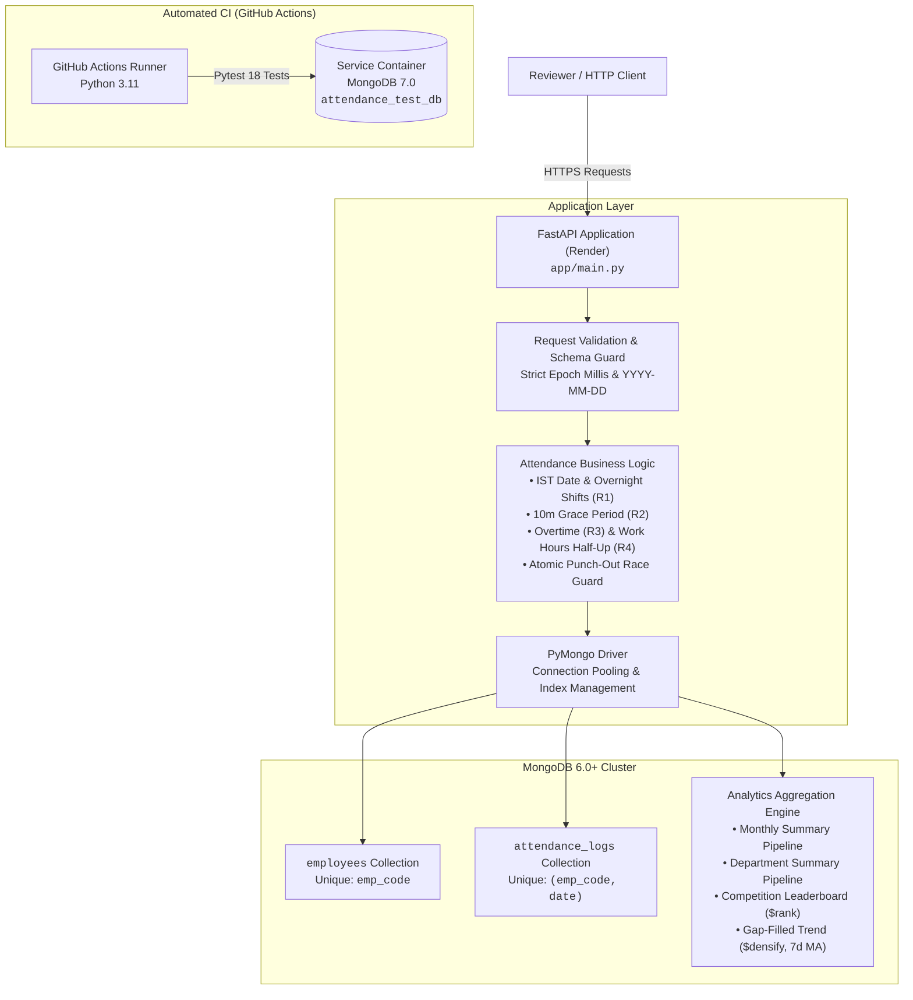

# Employee Attendance & Analytics API

[](https://www.python.org/)
[](https://fastapi.tiangolo.com/)
[](https://www.mongodb.com/)
[](https://github.com/ajayreddy510/employee-attendance-analytics-api/actions/workflows/tests.yml)
[](https://github.com/ajayreddy510/employee-attendance-analytics-api)

A robust, reviewer-ready Employee Attendance & Analytics REST API engineered with Python 3.11+, FastAPI, and MongoDB 6.0+. Developed for the **HROne Software Engineer Trainee** technical assignment, this service implements strict attendance validation, race-safe attendance punch-in/out operations, Indian Standard Time (IST) overnight shift management, audit-logged attendance regularizations, and database-native aggregation pipelines for departmental and organizational analytics.

---

## Live Deployment & Service Links

| Resource | URL | Description |
|---|---|---|
| **Base URL** | [https://hrone-attendance-api-7vq3.onrender.com/](https://hrone-attendance-api-7vq3.onrender.com/) | Live API root (automatically issues HTTP 307 redirect to Swagger UI) |
| **Interactive Docs (Swagger UI)** | [https://hrone-attendance-api-7vq3.onrender.com/docs](https://hrone-attendance-api-7vq3.onrender.com/docs) | Full interactive OpenAPI test client and schema explorer |
| **Health Check** | [https://hrone-attendance-api-7vq3.onrender.com/health](https://hrone-attendance-api-7vq3.onrender.com/health) | Readiness probe (returns `{"status":"ok"}` when MongoDB responds to a ping) |
| **OpenAPI Specification (JSON)** | [https://hrone-attendance-api-7vq3.onrender.com/openapi.json](https://hrone-attendance-api-7vq3.onrender.com/openapi.json) | Raw OpenAPI schema definition |
| **GitHub Repository** | [ajayreddy510/employee-attendance-analytics-api](https://github.com/ajayreddy510/employee-attendance-analytics-api) | Source code repository and issue tracker |
| **CI / CD Pipeline** | [GitHub Actions Workflow](https://github.com/ajayreddy510/employee-attendance-analytics-api/actions/workflows/tests.yml) | Continuous integration automated test suite status |

---

## Explore the Codebase

To explore the architecture, module relationships, and implementation details interactively:

* **[GitDiagram](https://gitdiagram.com/ajayreddy510/employee-attendance-analytics-api)**: Interactive, AI-generated visual overview of repository architecture, components, and connections. *(Note: AI-generated diagrams may simplify complex sub-pipelines and should be checked against repository source files).*
* **[GitIngest](https://gitingest.com/ajayreddy510/employee-attendance-analytics-api)**: Consolidated text digest of all repository source files formatted for LLM-assisted code exploration, code review, and prompt-driven analysis. *(External development aid; not part of the runtime service).*

---

## System Architecture



---

## API Surface

Contract endpoints strictly implement the specification defined in [`openapi.yaml`](openapi.yaml) and documented in [`DATA_MODEL.md`](DATA_MODEL.md), while `GET /` serves as a convenience redirect excluded from the OpenAPI schema:

| Method | Path | Summary & Parameters | Key Response Behaviors |
|---|---|---|---|
| `GET` | `/` | Root Redirect (`include_in_schema=False`) | `307 Temporary Redirect` forwarding clients directly to `/docs`. |
| `GET` | `/health` | Readiness Probe | Returns `200 OK` with `{"status":"ok"}` on successful MongoDB ping; `503` if unreachable. |
| `POST` | `/employees` | Register Employee | Creates an employee with shift times and calendar `joined_on`. Returns `201 Created` or `409 Conflict` on duplicate `emp_code`. |
| `GET` | `/employees` | List Employees (`department`, `page`, `page_size`) | Paginated employee list sorted strictly by `emp_code asc` (R10: `page >= 1`, max `page_size = 100`). Filterable by exact department name. |
| `POST` | `/attendance/punch-in` | Record Punch-In (`emp_code`, `punched_at`, `status`) | Calculates attendance date (R1) and late minutes (R2). Returns `201 Created` or `409 Conflict` on duplicate punch-in for the same date. |
| `POST` | `/attendance/punch-out` | Record Punch-Out (`emp_code`, `punched_at`) | Matches latest open punch-in, calculates work hours (R4), overtime (R3), and half-day status (R5). Returns `200 OK` or `409 Conflict` on concurrent punch-outs. |
| `GET` | `/attendance` | List Attendance Logs (`emp_code`, `date_from`, `date_to`, `status`, `page`, `page_size`) | Paginated attendance log entries sorted by `date desc, emp_code asc` (R10). Backed by compound index `IXSCAN`. |
| `PATCH` | `/attendance/{emp_code}/{date}` | Regularize Attendance (`reason`, `regularized_by`, status/punch overrides) | Recomputes derived metrics (work hours, overtime, late arrival) and appends an immutable change diff to `history[]`. |
| `GET` | `/analytics/employees/{emp_code}/monthly` | Monthly Summary (`month=YYYY-MM`) | Computes working days from `joined_on` (R7), weekdays present, late days, overtime minutes, and attendance percentage. |
| `GET` | `/analytics/departments/summary` | Department Metrics (`month=YYYY-MM`) | Aggregates headcount (R9; including employees with zero attendance logs via `$lookup` and `$unwind` with `preserveNullAndEmptyArrays`), present count, and average work hours. |
| `GET` | `/analytics/leaderboard/late` | Late-Comer Leaderboard (`month=YYYY-MM`, `limit`) | Computes competition ranking (`1, 2, 2, 4`) for late arrivals using `$setWindowFields` (`$rank`). |
| `GET` | `/analytics/departments/{department}/trend` | Department Attendance Trend (`from=YYYY-MM-DD`, `to=YYYY-MM-DD`) | Daily series gap-filled with `$densify` even if zero logs exist. Computes weekend null rates and 7-day trailing moving average. |
| `GET` | `/admin/explain/{endpoint}` | Explain Plan Inspection (`endpoint`, query parameters) | Returns raw MongoDB `executionStats` demonstrating winning plan stages (`IXSCAN`) and absence of `COLLSCAN`. |

---

## Core Engineering Features & Business Rules

### 1. Strict Timestamp & Date Validation
* **Epoch Milliseconds:** All `punched_at` inputs require strict integers in milliseconds within `[100000000000, 4102444800000]`. Booleans (e.g. `True`), floats (e.g. `1783312500000.5`), strings, and seconds-scale timestamps are rejected with HTTP 422.
* **Whole-Second Determinism (R1):** Epoch conversions truncate cleanly to whole-second milliseconds (`sec * 1000`), ensuring microsecond BSON datetimes never introduce millisecond drift.
* **Strict Calendar Dates:** Calendar dates (`YYYY-MM-DD`) and months (`YYYY-MM`) enforce exact component regex validation and calendar boundary verification (`date(y, m, d)`), preventing out-of-range years (`0000`) and invalid days (e.g. Feb 31) from raising unhandled 500 errors.

### 2. Timezone & Overnight Shift Handling (R1)
* Shift start/end times and attendance calendar dates operate in Indian Standard Time (IST, `UTC+05:30`).
* For overnight shifts (`shift_end <= shift_start`, e.g. 22:00 to 06:00 IST), a punch-in prior to `shift_end` is attributed to the calendar date when the shift started on the previous day.

### 3. Grace Period & Late-Arrival Calculation (R2)
* An employee is late only if their punch-in occurs strictly more than 10 minutes past `shift_start` (i.e. $> 600$ seconds).
* Once late, `late_minutes` is calculated from the scheduled `shift_start`, not from the end of the grace period.

### 4. Overtime & Decimal Work-Hour Rounding (R3, R4, R8)
* **Overtime Threshold (R3):** Overtime (`overtime_minutes`) is counted only if punch-out is at least 30 whole minutes past `shift_end`; otherwise, it records `0`.
* **Half-Up Rounding (R4, R8):** Work hours are calculated using Decimal arithmetic and rounded using `ROUND_HALF_UP`. Reported analytics rates also use half-up rounding at the final rounding step, avoiding Python’s ties-to-even behavior.

### 5. Half-Day & Presence Classification (R5, R6)
* **Half-Day Classification (R5):** An attendance record is classified as `half_day: True` if total work hours are strictly less than 4.50 hours. A half day counts as 0.5 of a present day.
* **Presence Statuses (R6):** Statuses `PRESENT`, `WFH`, and `ON_DUTY` count as present. `ABSENT` and `LEAVE` do not.

### 6. Concurrency Safety & Race-Condition Prevention
* **Duplicate Punch-In Protection:** Enforced by unique compound index `{"emp_code": 1, "date": 1}`. Simultaneous punch-in requests result in exactly one HTTP 201 and HTTP 409 Conflict for all concurrent attempts.
* **Atomic Punch-Out Guard:** Punch-out uses MongoDB atomic `find_one_and_update({"_id": ..., "punch_out": None}, ...)` to guarantee simultaneous punch-out requests cannot close the same attendance record twice.

### 7. Audit History on Regularization
* Manual corrections (`PATCH /attendance/{emp_code}/{date}`) record an immutable audit history item in `history[]` capturing `at` (epoch ms), `by` (free-text author / manager ID), `reason`, and a typed before-and-after diff (`{"from": ..., "to": ...}`).
* Works safely on legacy records with missing `history` fields.

### 8. Analytics Aggregation Pipelines (R7, R9)
* **Working Days from Join Date (R7):** Monthly analytics compute working days (Mon–Fri) from `joined_on`. Weekend records contribute to late minutes and overtime minutes, but not to standard weekday working day counts.
* **Zero-Log Headcount Inclusion (R9):** Department summary originates from employees whose `joined_on` is on or before the period end (`joined_on <= end_of_month`), performs a `$lookup` into attendance logs, and unwinds with `preserveNullAndEmptyArrays: true`. Grouping by department with `{"$addToSet": "$emp_code"}` guarantees employees with zero attendance logs are accurately included in total headcount.
* **Continuous Date Series with `$densify`:** Department trends generate complete date ranges inside MongoDB aggregation using `$densify`, maintaining continuous 7-day moving averages even for date ranges with zero attendance logs.
* **Competition Ranking:** Leaderboards apply standard competition ranking (`1, 2, 2, 4`) via `$setWindowFields` with `$rank`.

### 9. Pagination (R10)
* List endpoints (`/employees`, `/attendance`) enforce 1-based pagination (`page >= 1`, default `page_size = 20`, max `page_size = 100`).
* Response metadata reflects total matching records after applying query filters (`department`, `emp_code`, `date_from`, `date_to`, `status`).

---

## Setup & Reproducibility

### Prerequisites
* Python 3.11+
* MongoDB 6.0+ (MongoDB Atlas or local MongoDB instance)

### 1. Environment Configuration
Clone the repository and create an isolated virtual environment:
```bash
git clone https://github.com/ajayreddy510/employee-attendance-analytics-api.git
cd employee-attendance-analytics-api

python -m venv .venv
source .venv/bin/activate  # On Windows: .venv\Scripts\activate

# Install production dependencies
pip install -r requirements.txt

# Install development and testing dependencies
pip install -r requirements-dev.txt
```

Create a `.env` configuration file (reference [`.env.example`](.env.example)):
```env
MONGO_URI=mongodb://localhost:27017
MONGO_DB=attendance_db
```

### 2. Seeding Sample Data (Optional)
> ⚠️ **Warning:** `sample_seed.py` wipes (`delete_many({})`) and re-seeds the `employees` and `attendance_logs` collections in the configured `MONGO_DB`. **Never run sample seeding against a production or live evaluation database.**
```bash
python sample_seed.py
```

### 3. Running the API Locally
Start the server with Uvicorn:
```bash
uvicorn app.main:app --port 8000
```
* Interactive Swagger UI: `http://localhost:8000/docs`
* Root redirect: `http://localhost:8000/` $\rightarrow$ `http://localhost:8000/docs`
* Health probe: `http://localhost:8000/health`

### 4. Running Automated Tests
Run the comprehensive 18-test regression and concurrency test suite:
```bash
python -m pytest tests/test_api.py -v
```
> ⚠️ **Test Isolation Notice:** The test suite operates strictly against an isolated database (`attendance_test_db` via `TEST_MONGO_URI`, defaulting to `mongodb://localhost:27017`). The pytest test fixture wipes test collections in `attendance_test_db` before and after test runs. **Never configure `TEST_MONGO_URI` with production credentials.**

---

## Technology Stack & Design Decisions

### Tech Stack
* **Language & Runtime:** Python 3.11+
* **Web Framework:** FastAPI (Asynchronous ASGI, OpenAPI automatic generation, Starlette responses)
* **Schema Validation:** Pydantic v2 (Strict type checking, custom field and model validators)
* **Database Driver:** PyMongo (Official thread-safe MongoDB driver)
* **Database Engine:** MongoDB 6.0+ (Atlas cloud and native Linux containers)
* **Testing:** Pytest, HTTPX, ThreadPoolExecutor (Multi-threaded HTTP race testing)

### Design Decisions
* **Single File Architecture:** In accordance with the assignment kit design, the full service logic is maintained cleanly within [`app/main.py`](app/main.py).
* **Database-Native Analytics:** Analytics calculations (working days, moving averages, gap densification, rank calculations) are executed entirely inside MongoDB aggregation pipelines rather than loading raw logs into Python memory.
* **Compound Indexes & Concurrency Strategy:** Index rationale, concurrency decisions, and scaling considerations are documented in [`DECISIONS.md`](DECISIONS.md). Key analytical and listing queries are verified against winning plan `IXSCAN` stages via explain-plan regression checks in [`tests/test_api.py`](tests/test_api.py).
* **Security & Authentication Scope:** Authentication and authorization are intentionally excluded to conform directly to the assignment specification. This project is an assignment demonstration and should not be used with real employee data without adding authentication (e.g. JWT/OAuth2) and role-based access control.

---

## Key Repository Files

| File | Purpose |
|---|---|
| [`app/main.py`](app/main.py) | Application entrypoint, FastAPI routes, business logic, and aggregation pipelines |
| [`tests/test_api.py`](tests/test_api.py) | Automated test suite covering validation, concurrency races, rules R1–R5, and analytics |
| [`requirements.txt`](requirements.txt) | Core production dependencies |
| [`requirements-dev.txt`](requirements-dev.txt) | Development and testing dependencies (`pytest`, `httpx`) |
| [`DATA_MODEL.md`](DATA_MODEL.md) | Database schemas, document shapes, and indexing requirements |
| [`openapi.yaml`](openapi.yaml) | Official assignment OpenAPI 3.0 contract specification |
| [`DECISIONS.md`](DECISIONS.md) | Index rationale, concurrency decisions, and scaling considerations |
| [`REVIEW.md`](REVIEW.md) | In-depth defect analysis and code review of the starter candidate kit |
| [`.env.example`](.env.example) | Environment variable template with configuration instructions |
| [`render.yaml`](render.yaml) | Render Infrastructure-as-Code Blueprint specification (`plan: free`) |
| [`.github/workflows/tests.yml`](.github/workflows/tests.yml) | GitHub Actions CI workflow with MongoDB 7.0 service container |

---

## Deployment (Render)

The application is deployed as a Web Service on Render using [`render.yaml`](render.yaml):
* **Service Name:** `employee-attendance-analytics-api` (Blueprint resource: `employee-attendance-analytics-api`, Service ID: `srv-db4uo6g473hc7397mrmg`)
* **Public URL:** [https://hrone-attendance-api-7vq3.onrender.com/](https://hrone-attendance-api-7vq3.onrender.com/)
* **Build Command:** `pip install -r requirements.txt`
* **Start Command:** `uvicorn app.main:app --host 0.0.0.0 --port $PORT`
* **Plan:** Free tier (`plan: free`)
* **Environment Variables:**
  * `MONGO_URI`: Secure MongoDB Atlas connection string (configured as an encrypted environment secret)
  * `MONGO_DB`: `attendance_db`
  * `PYTHON_VERSION`: `3.11.9`
